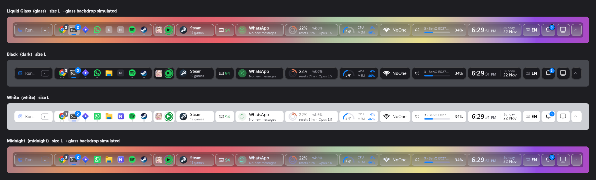
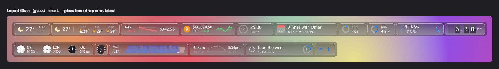
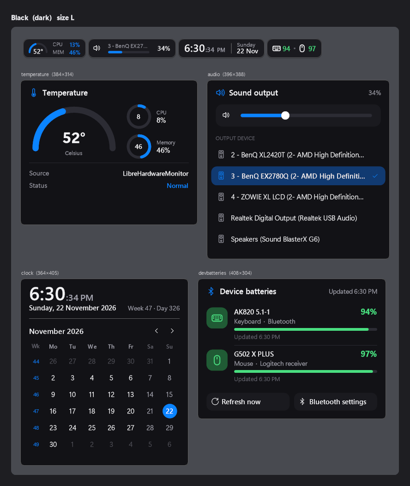
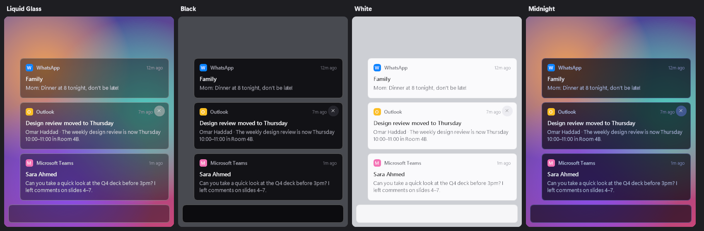
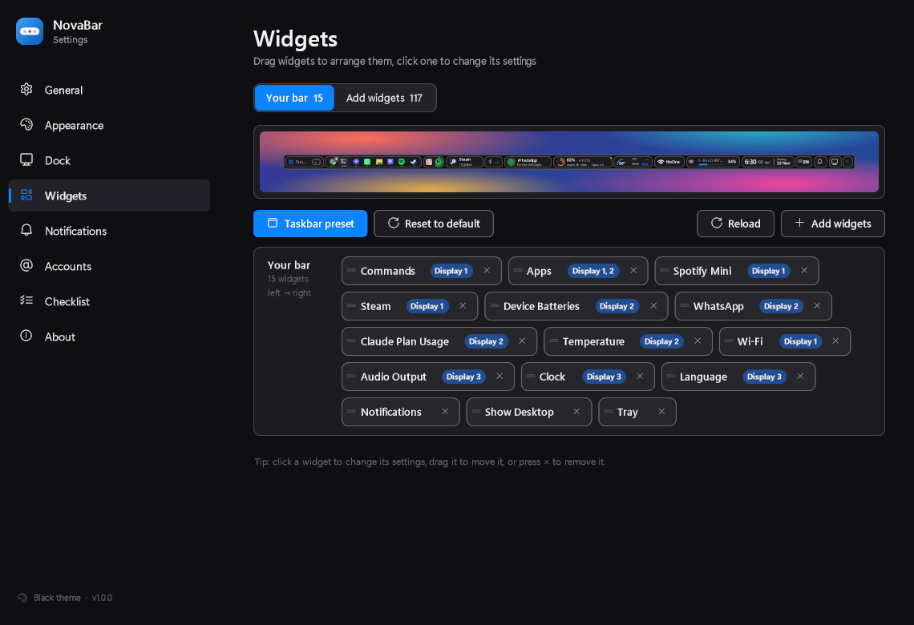
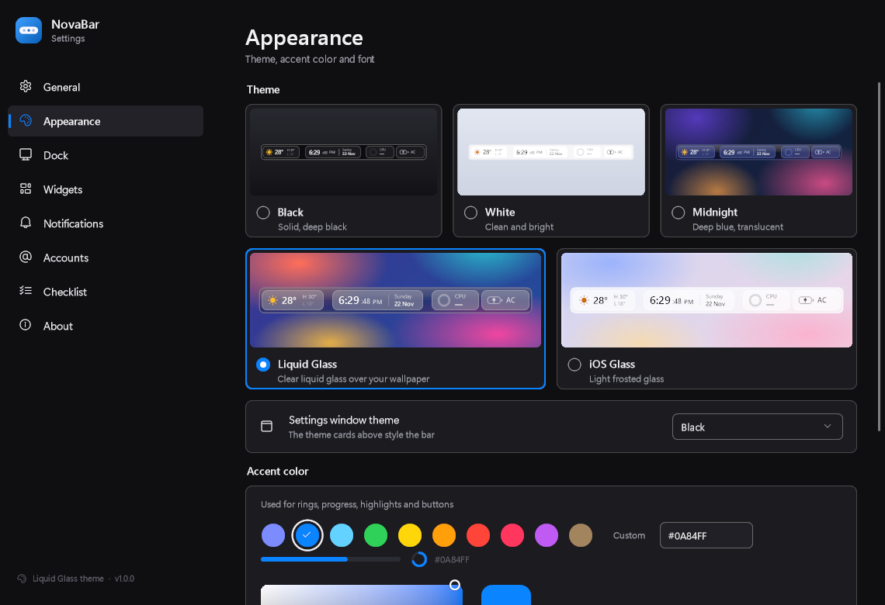
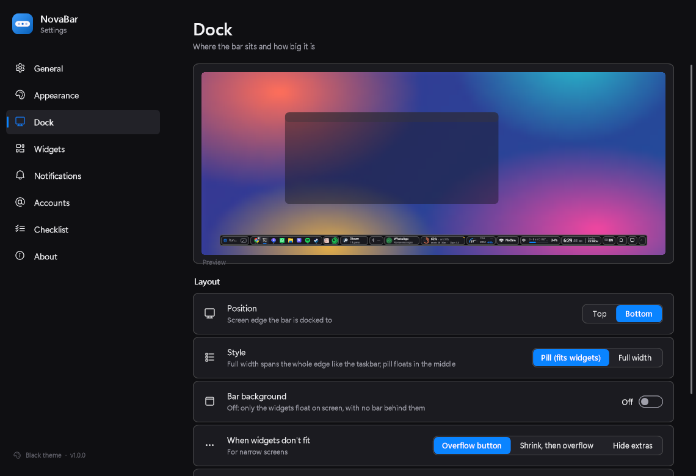
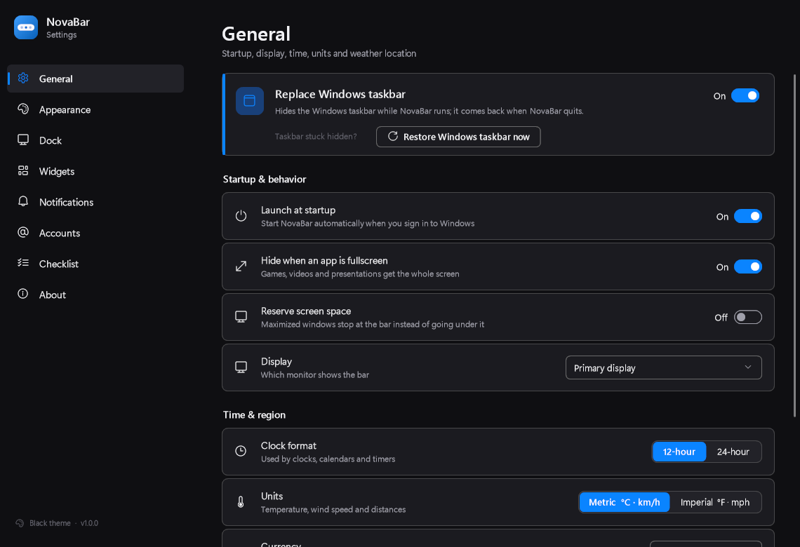
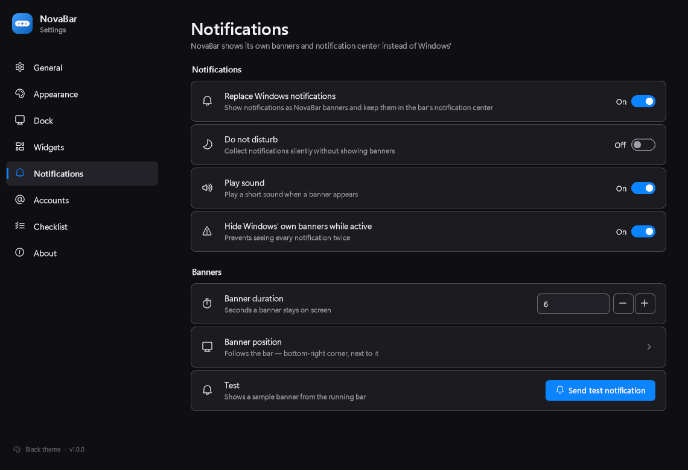
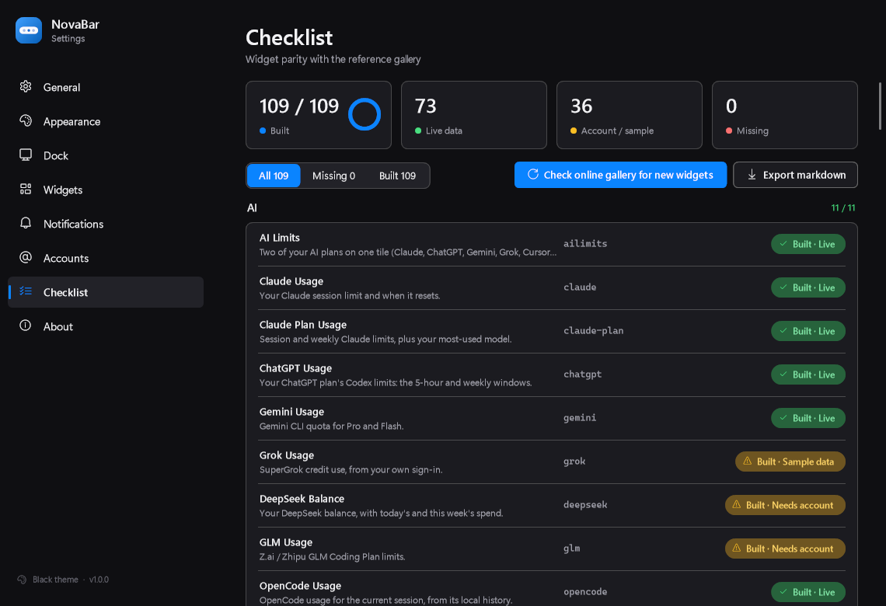

# NovaBar

A lightweight widget bar that **replaces the Windows taskbar**. It's one floating row of glassy tiles: your apps and open windows, media, system stats, Wi-Fi, sound, clock, notifications and the tray, plus 100+ optional widgets. A separate Settings app controls all of it.

It's a native Windows app written in C# 5 against the .NET Framework that ships with Windows. There's nothing to install and no Electron. It typically uses about 2–3% of one CPU core and 30–50 MB of RAM.



---

## Highlights

- **Taskbar replacement.** Hides the Windows taskbar and stops it from popping back up. Start, pinned apps, open windows, the tray, Show Desktop and the Win key all work. The taskbar comes back when NovaBar quits.
- **Fits your widgets.** The pill-shaped bar is only as wide as your widgets, and it floats above every window without reserving screen space. Turn off **Bar background** and each widget floats as its own tile.
- **Multi-monitor.** Choose which widgets appear on each display. Portrait screens work too, and when widgets don't fit, the extras go behind an overflow **»** button.
- **Apps widget.**
  - **Grouping:** windows of the same app share one icon, with a count badge whose color, size and number color you can change.
  - **Previews:** hover a group to see a live thumbnail of each window.
  - **Reordering:** drag icons to rearrange them right on the bar.
  - **Pinning:** works for normal and Microsoft Store apps.
- **Commands.** Press Alt+Space or tap the Win key for a launcher. It finds apps and runs actions like Lock, Sleep, Hibernate and Restart.
- **Notifications.** NovaBar shows its own banners and a notification center instead of Windows' own.
- **Tray.** Icons are split into a pinned section and a hidden section, and you can reorder them. Right-click opens each app's own tray menu.
- **Themes.** Black, White, Midnight, Liquid Glass and iOS Glass, with an accent color picker. The Settings window can use a different theme from the bar.
- **Right-click any widget** to open its details or settings, move it, choose which monitors show it, or remove it. You can also reload NovaBar from this menu.
- **Fullscreen aware.** The bar hides for fullscreen games and videos, and stays visible for windows that are only maximized.

## Widgets

The [widget checklist](docs/widget-checklist.md) has the full list: 109 widgets, matching the lumabar.xyz gallery one for one. Highlights:

| Category | Examples |
|---|---|
| System | CPU, RAM, temperature, network, Wi-Fi, battery, brightness, quick toggles, top processes, Bluetooth device batteries |
| Media & audio | Now playing, Spotify, Spotify mini, sound output, microphone |
| Clocks & weather | Clock + calendar, flip clock, world clocks, analog, forecast, hourly, sunrise/sunset |
| Productivity | Calendar, to-dos, notes, Pomodoro, timer, screen time, WhatsApp |
| AI | Claude, ChatGPT, Gemini and other plan-usage meters |
| Finance & stocks | Stripe, Polar, Shopify, Paddle, Gumroad and more; stock, watchlist, crypto |
| Games | Steam library, friends, playtime |



Click a widget to open its details panel:



Notification banners in each theme:



## The Settings app

Open it by right-clicking the bar and choosing **NovaBar settings**, or by running `NovaBar.exe --settings`.

| | |
|---|---|
| **Widgets:** your bar as one ordered row. Drag to reorder, choose monitors, or add from 117 widgets.  | **Appearance:** bar theme, a separate Settings window theme, and an accent color picker.  |
| **Dock:** position, pill or full width, bar background, and what happens when widgets don't fit.  | **General:** taskbar replacement, launch at startup, fullscreen behavior, units and region.  |
| **Notifications:** replace Windows banners, Do not disturb, sound and duration.  | **Checklist:** parity with the reference gallery, including a check for newly published widgets.  |

## CPU temperature

Windows doesn't give normal apps the CPU temperature on most desktop CPUs, Ryzen included. The **Temperature** widget reads it automatically from any one of these:

- **LibreHardwareMonitor** with *Remote Web Server* turned on, listening on `127.0.0.1:8085`. It needs the PawnIO driver, which it offers to install on first launch.
- **HWiNFO** with *Shared Memory Support* turned on
- **OpenHardwareMonitor**

## Build

Requirements: Windows 10/11 and WSL. The build uses Windows' built-in `csc.exe` from .NET Framework 4.x, so the code must stay at C# 5.

```bash
scripts/build.sh live          # → C:\Users\<you>\NovaBar\build\live\NovaBar.exe
scripts/deploy-live.sh         # stop the running bar, swap in the new exe, start it
scripts/package.sh             # full build + dist folder
python3 scripts/check-new-widgets.py   # compare against the online gallery
```

Useful command-line switches:

| Switch | What it does |
|---|---|
| `--settings [page]` | Open Settings (`general`, `appearance`, `dock`, `widgets`, `notifications`, `accounts`, `checklist`, `about`) |
| `--exit` | Quit the running bar (restores the Windows taskbar) |
| `--restore-taskbar` | Bring the Windows taskbar back if it's ever stuck hidden |
| `--render out.png [--themes ...] [--widgets a,b] [--panels]` | Render widgets offscreen to a PNG (used for the screenshots above) |

Configuration is stored in `%APPDATA%\NovaBar\config.json`, and per-widget state in `%APPDATA%\NovaBar\state\`.

## Project layout

```
src/Core      config, JSON, theming, drawing helpers, widget contract, HTTP
src/Bar       bar window, renderer, glass, overflow, menus, taskbar hiding
src/App       entry point, offscreen renderer
src/Settings  the Settings app
src/Widgets   widgets grouped by category (Controls, SystemMonitor, Media, Notify, ...)
data/         reference widget list (lumabar gallery)
docs/         checklist, notes, screenshots
scripts/      build / deploy / package / gallery check
```
